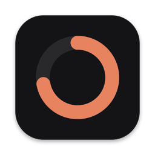
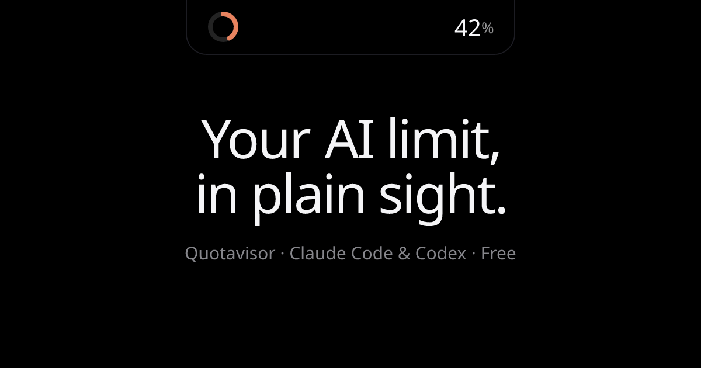
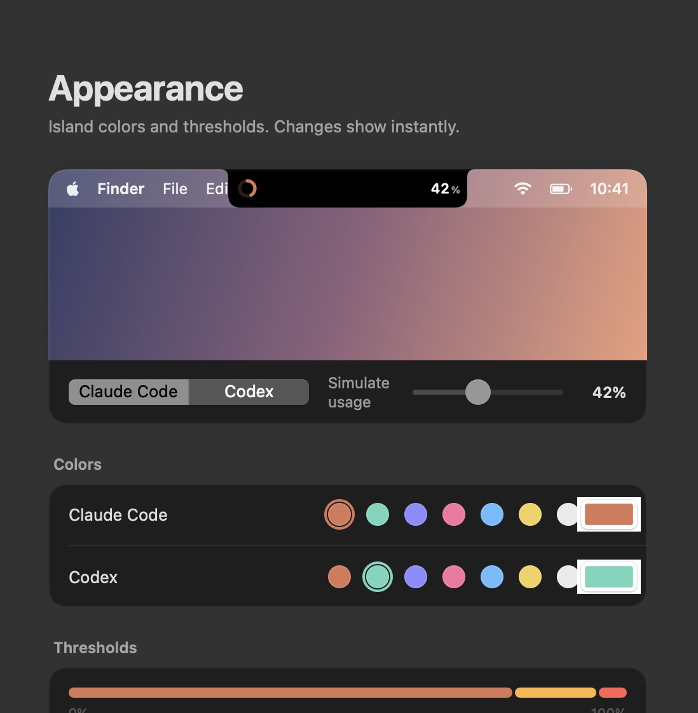
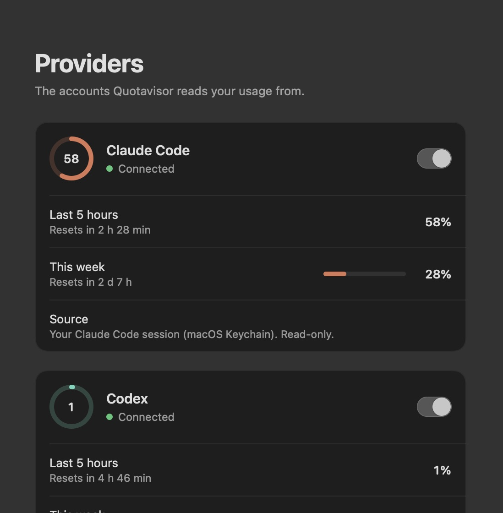

<div align="center">



# Quotavisor

**Your Claude Code and Codex limits, living in your Mac's notch.**

See how much of your 5-hour and weekly window is left at a glance,<br />
before the limit cuts you off mid-task.

[](https://github.com/humberDEV/quotavisor/releases/latest)
[](#requirements)
[](#requirements)
[](LICENSE)

[**Website**](https://quotavisor.vercel.app) · [**Install**](#install) · [**How it works**](#how-it-works) · [**Build from source**](#build-from-source)

<br />



</div>

<br />

## Install

Open **Terminal** and paste:

```bash
curl -fsSL https://quotavisor.vercel.app/install.sh | bash
```

It checks your Mac, downloads the [latest release](https://github.com/humberDEV/quotavisor/releases/latest), copies **Quotavisor.app** to `/Applications` and opens it. Run the same command again to update.

> [!TIP]
> The script is a couple dozen lines. [Read it first](https://quotavisor.vercel.app/install.sh) if you like knowing what you run.

<br />

## What you get

<table>
<tr>
<td width="50%" valign="top">

### Collapsed
A ring and a percentage for the provider you're using right now, or the one you pin. It sits in the notch and stays out of your way.

</td>
<td width="50%" valign="top">

### On hover
The island opens with both providers: how much of the **5-hour window** you've used and when it resets, plus your **weekly** usage and how long until it resets.

</td>
</tr>
<tr>
<td width="50%" valign="top">

### Warns before it hurts
The ring turns **amber** at 80% and **red** at 95%. You set both thresholds.

</td>
<td width="50%" valign="top">

### Right-click for the rest
Refresh now, choose what to show, how often to read (1–30 min), open at login, quit.

</td>
</tr>
</table>

<br />

<div align="center">


</div>

<br />

| | |
|---|---|
| **Memory** | ≈ 55 MB |
| **CPU at rest** | 0 % |
| **Reads** | every 1–30 min, your choice |
| **Languages** | English, Español, Français (follows your Mac) |
| **Without a notch** | sits as a small pill below the menu bar |

<br />

## How it works

Quotavisor reads the same numbers your tools already have. Nothing goes through a Quotavisor server, because there isn't one, and there's no analytics.

**Claude Code** — Quotavisor asks `api.anthropic.com/api/oauth/usage` for your usage with the OAuth session Claude Code already keeps in your Keychain (`Claude Code-credentials`). It only reads that token and never sends it anywhere else. The first time, macOS asks whether Quotavisor may read it: choose **Always Allow**.

If that session has expired, Quotavisor can run `claude -p` once with Haiku (at most every 20 minutes) so Claude Code refreshes its own session. That one tiny request counts towards your usage.

**Codex** — Quotavisor reads the `rate_limits` that Codex writes to its local logs in `~/.codex/sessions`. No network at all.

<br />

## Requirements

- macOS 14 Sonoma or later
- A Mac with Apple Silicon
- Claude Code signed in (`claude login`) and/or Codex used at least once

<br />

## Build from source

```bash
git clone https://github.com/humberDEV/quotavisor.git
cd quotavisor
./build.sh && open build/Quotavisor.app
```

| Script | What it does |
|---|---|
| `./build.sh` | Builds `build/Quotavisor.app` (release, arm64) |
| `./install.sh` | Builds, installs to `/Applications` and relaunches |
| `./make-dmg.sh` | Builds `build/Quotavisor.dmg` |

A single Swift package with no dependencies: SwiftUI for the island and settings, AppKit for the borderless panel over the notch.

<br />

## FAQ

<details>
<summary><b>Why a Terminal command instead of a DMG?</b></summary>
<br />
Quotavisor isn't notarized by Apple yet. A DMG downloaded in the browser gets blocked by Gatekeeper; the same app downloaded with <code>curl</code> opens normally. The DMG is still attached to every release, and you can always build it yourself.
</details>

<details>
<summary><b>Does it ask for Accessibility or Screen Recording?</b></summary>
<br />
No. The only prompt is the Keychain one for reading the Claude Code session.
</details>

<details>
<summary><b>How do I uninstall it?</b></summary>
<br />
Right-click the island → <b>Quit Quotavisor</b>, then delete <code>/Applications/Quotavisor.app</code>.
</details>

<br />

## Feedback

Something broken, missing, or too much? Tell me on X: [**@humbergarc**](https://x.com/humbergarc). Issues and pull requests are welcome too.

<br />

---

<div align="center">
<sub>
Made by <a href="https://x.com/humbergarc">@humbergarc</a> · <a href="LICENSE">MIT License</a><br />
Quotavisor is not affiliated with Anthropic or OpenAI. Claude, Claude Code and Codex are trademarks of their respective owners.
</sub>
</div>
